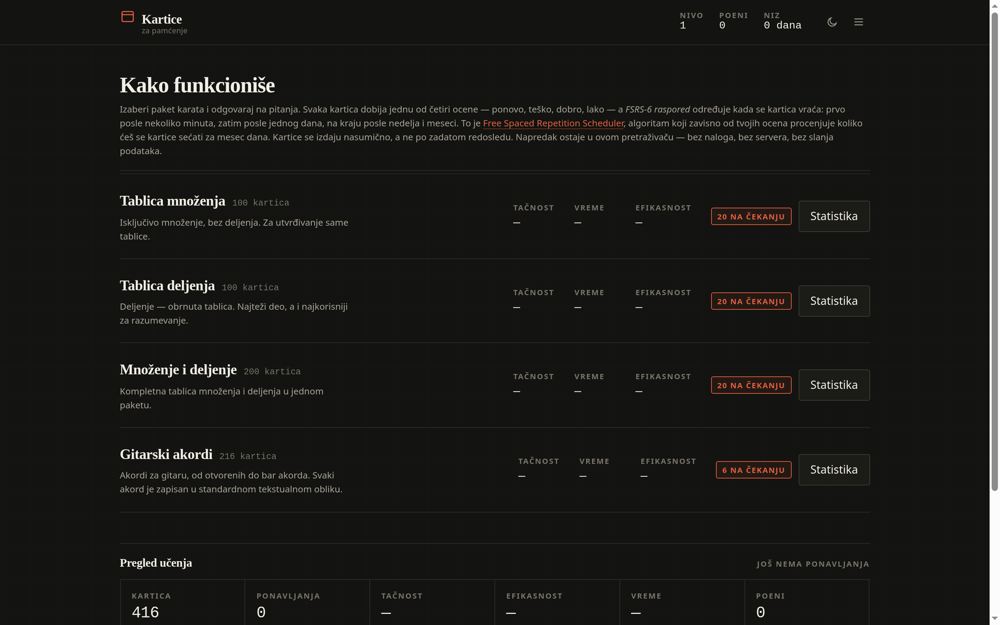
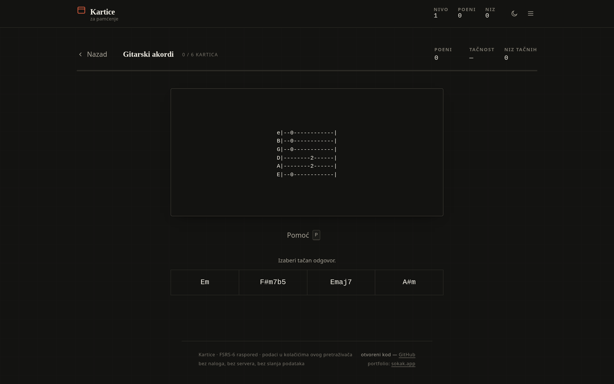
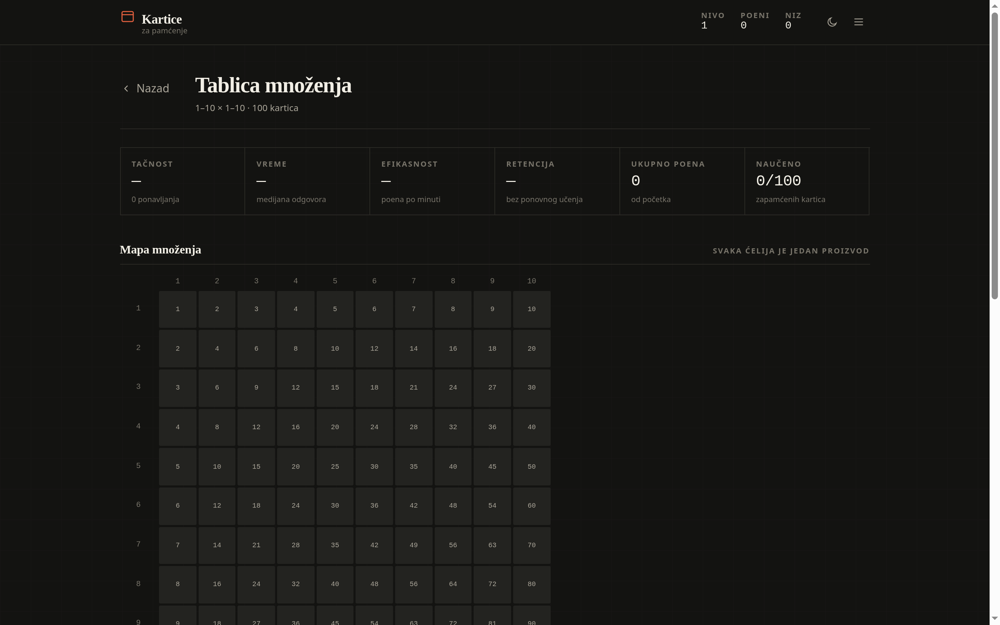
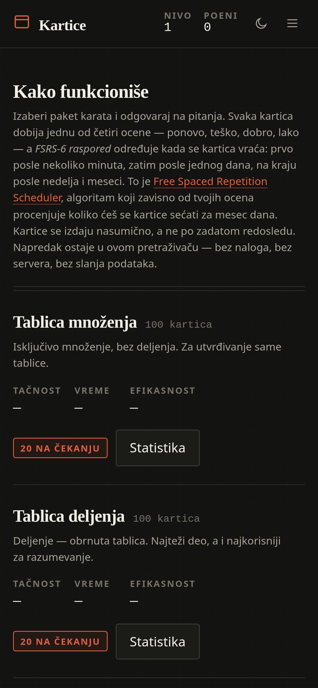

<div align="center">

# Kartice

**Sajt za učenje sa pamćenjem na razmak — bez naloga, bez servera, bez slanja podataka.**

[▶ Otvori sajt](https://kartice.sokak.app/) · [Portfolio](https://sokak.app/) · [Issue](https://github.com/banegrbic/kartice/issues)

</div>

---

## Šta je ovo

Kartice su web aplikacija za učenje napamet: biraš paket kartica, odgovaraš,
a **FSRS-6** raspored određuje kada se svaka kartica vraća. Nema naloga, nema
servera i nema slanja podataka — sav progres živi u kolačićima tvog pretraživača.

Pravi se **FSRS-6** (Free Spaced Repetition Scheduler) implementacija, koja je
diferencijalno testirana protiv reference biblioteke `ts-fsrs` v6.0.0 — 463
randomizovane sekvence, nula neslaganja.

## Screenshotovi

| Paketi karata | Učenje — kviz sa akordima |
|---|---|
|  |  |

| Statistika | Mobilni prikaz |
|---|---|
|  |  |

## Paketi karata

| Paket | Kartica | Opis |
|---|---|---|
| Tablica množenja | 100 | samo množenje 1–10 × 1–10 |
| Tablica deljenja | 100 | obrnuta tablica |
| Množenje i deljenje | 200 | kompletna tablica u jednom paketu |
| Gitarski akordi | 216 | 12 osnovnih tonova × 18 vrsta akorda |

Svih **216 akorda** je provereno na pravoj gitari: tonovi koje oblik svira
jesu tačno tonovi akorda, osnovni ton je u basu, oblik stane u četiri praga.
Generator reprodukuje svih 26 otvorenih oblika sa štampanih akord kartica bez
i jedne razlike.

Akordi se uče **u redosledu početniku pristojan**: prvo osnovni otvoreni
(Em Am C G D A E Dm), pa najteža dvojica klasične desetke (F Bm), pa
dominantne sedmice, pa male sedmice, i tek na kraju bar akordi i egzotika.

## Šta je još u aplikaciji

- **„Pomoć"** na svakoj kartici — otkriva tačan odgovor. Ne donosi poene, ali
  kartica se i dalje rasporeduje: bila je pregledana, samo ne vredi.
- **Kviz** za akorde — četiri ponuđena odgovora, tačno jedan ispravan.
- **Statistika** — tačnost, vreme, efikasnost, retencija, i mapa napretka.
- **Tema** — svetla („papir") i tamna („škola").
- **Izvoz** progresa u JSON.

## Tehnologija

Čist **HTML, CSS i JavaScript**. Bez framework-a, bez build procesa, bez
runtime zavisnosti, bez servera. Otvori `index.html` i radi.

```
index.html               shell: masthead + 3 viewa + podešavanja
css/style.css            dizajn-tokeni, tema, responsive
js/fsrs.js               FSRS-6 scheduler (port reference biblioteke)
js/storage.js            cookie store: base64url + chunking
js/deck-registry.js      ugovor deka + registar + generički defaultovi
js/deck-tablica-mnozenje.js
js/deck-tablica-deljenje.js
js/deck-tablica.js
js/deck-akordi.js        paket „Gitarski akordi" (216 kartica) + kviz
js/scoring.js            scoring model
js/state.js              stanje, red čekanja, statistika
js/app.js                UI kontroler, routing, renderovanje
test/                    unit i diferencijalni test
```

**Arhitektura:** svaki paket kartica je u **zasebnom fajlu** i sam se
prijavljuje (`Decks.register()`). Motor ne zna ništa o temi. Dodavanje nove
teme znači: novi fajl i jedan red u `index.html` — nikad izmena motora.

## Razvoj

Projekt nema build korak. Za lokalni pregled:

```bash
python3 -m http.server 8000
# → http://127.0.0.1:8000/
```

Testovi:

```bash
node test/app.test.mjs         # 92 test grupe
node test/fsrs.diff.test.mjs   # 463 sekvenci vs ts-fsrs v6.0.0
```

`fsrs.diff.test.mjs` traži referentnu biblioteku:

```bash
mkdir -p fsrs-ref && cd fsrs-ref
npm init -y && npm install ts-fsrs@6.0.0
```

Put se menja preko `FSRS_REF_ROOT`.

Detaljan opis arhitekture, ugovora deka i pravila za srpski tekst je u
[`PROJEKT.md`](PROJEKT.md).

## Doprinosi

Voljni su i pozdravljeni. Pogledaj [CONTRIBUTING.md](CONTRIBUTING.md).

Najviše koristi:
- **novi paket kartica** — novi fajl + jedan red u `index.html`
- **dostavljanje akorada** — oblik mora biti proveren na pravoj gitari
- **preporuke za redosled učenja** — zasnovane na tome šta početnik prvo treba

## Licenca

[MIT](LICENSE) © 2026 Bane Grbić

## Kontakt

[Portfolio](https://sokak.app/) · [GitHub](https://github.com/banegrbic) ·
[e-mail](mailto:bane.grbic@gmail.com)
